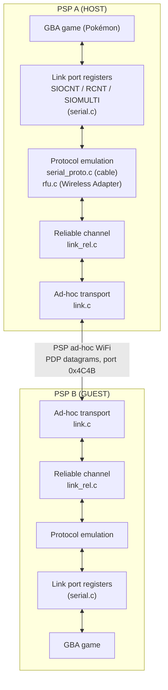
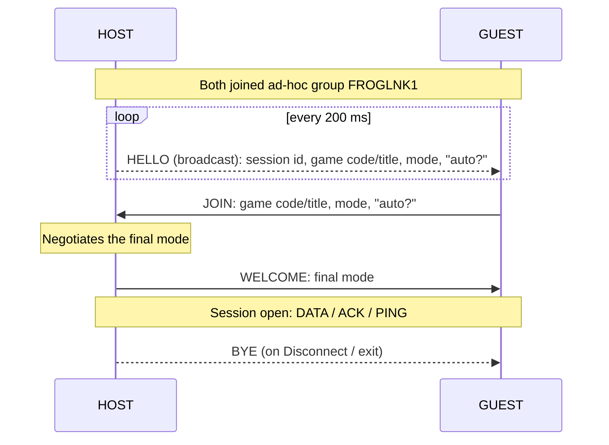

# How it works

This document explains how FrogGBA links two PSPs so that two GBA games think they are connected by a link cable or by GBA Wireless Adapters. It's meant for developers and for anyone curious about the internals. For usage, see the [Multiplayer guide](MULTIPLAYER_GUIDE.md).

- [1. The problem](#1-the-problem)
- [2. Architecture](#2-architecture)
- [3. The ad-hoc transport (`link.c`)](#3-the-ad-hoc-transport-linkc)
- [4. The reliable channel (`link_rel.c`)](#4-the-reliable-channel-link_relc)
- [5. Link port emulation (`serial.c`)](#5-link-port-emulation-serialc)
- [6. Pokémon cable mode (`serial_proto.c`)](#6-pokémon-cable-mode-serial_protoc)
- [7. Wireless Adapter mode (`rfu.c`)](#7-wireless-adapter-mode-rfuc)
- [8. Integration with the emulator](#8-integration-with-the-emulator)
- [9. Saving during a link session](#9-saving-during-a-link-session)
- [10. Diagnostics](#10-diagnostics)
- [11. Known limitations](#11-known-limitations)
- [12. Source map](#12-source-map)

---

## 1. The problem

A GBA link cable is **synchronous**. When the master GBA starts a transfer, every connected GBA shifts its 16-bit word out and receives the others' words within microseconds, and then a serial interrupt fires on all of them. The games rely on this timing.

Two PSPs talking over WiFi are **asynchronous**: a message takes milliseconds to arrive, sometimes much longer, and sometimes it never arrives. Forwarding each raw transfer over the air and waiting for the reply would freeze the emulated CPU for milliseconds on every word. Games transfer thousands of words per second, so that can't work.

The solution, taken from [gpSP for libretro](https://github.com/libretro/gpsp) by David Guillen Fandos, is **high-level emulation of the link protocols**:

- Each PSP emulates the *other* console locally. Its own game always gets an immediate answer, just as with a real cable.
- Only the **game data** goes over the network (for example, the 8-word blocks of the Pokémon protocol, or the packets sent through the Wireless Adapter). It is queued on arrival and fed to the game when the game's protocol expects it.
- The game's own protocol tolerates the extra latency. Its blocks simply arrive "later", as if the other player were slower.

This only works for protocols that are emulated, which is why there are several **modes** (Pokémon cable, Advance Wars cable, Wireless Adapter).

gpSP was designed for RetroArch netplay over TCP. On the PSP there is no TCP between consoles, only **ad-hoc PDP datagrams**, which can be lost, duplicated or reordered. So this fork adds a transport with its own reliability layer, plus PSP-specific fixes for timing, thread scheduling and flow control.

## 2. Architecture

| Layer | File | Role |
|---|---|---|
| Menu | `gui.c` | *Link cable (ad-hoc)* submenu: mode, debug log, connect and disconnect, status. |
| Transport | `link.c` | Brings up the PSP network stack, joins the ad-hoc group, pairs HOST and GUEST, negotiates the mode, runs the session, sends and receives datagrams. |
| Reliable channel | `link_rel.c` | Exactly-once, in-order delivery of protocol messages over lossy datagrams. No PSP dependencies, so it is unit tested on a PC. |
| Link port | `serial.c` | Emulates the GBA serial registers and schedules serial events. Dispatches to the active protocol. |
| Protocols | `serial_proto.c`, `rfu.c` | Pokémon and Advance Wars cable protocols, and the Wireless Adapter. Ported from gpSP. |
| Diagnostics | `link_log.c` | Optional `link_log.txt` with events and a status line per second. |
| Saving | `memory.c` | Background Memory Stick writes while a session is open. |

The protocol code sees the HOST as client `0` and the GUEST as client `1`, the same convention as gpSP's RetroArch netplay. That keeps the ported code almost unchanged.

## 3. The ad-hoc transport (`link.c`)

### Network bring-up

When the player chooses *Connect as HOST/GUEST*, `link.c`:

1. Checks that a game is loaded and the **WLAN switch** is on.
2. Loads the PSP network modules (`sceUtilityLoadNetModule`) and initializes `sceNet`, `sceNetAdhoc` and `sceNetAdhocctl`. The network stack threads are created at **priority 0x18**, higher than the emulator thread (0x20). Otherwise a busy emulator delays incoming packets and they arrive in bursts.
3. Joins the ad-hoc group **`FROGLNK1`**, with product code `FROG00001`. This times out after 20 s.
4. Opens a PDP socket on port **0x4C4B** ("LK").

### Datagram format

Every datagram starts with a 20-byte header:

| Offset | Size | Field |
|---|---|---|
| 0 | 4 | Magic `FGL1` (0x46474C31) |
| 4 | 1 | Type: 1 HELLO, 2 JOIN, 3 WELCOME, 4 DATA, 5 ACK, 6 PING, 7 BYE |
| 5 | 1 | Link protocol version (currently **3**). Datagrams with a different version are ignored. |
| 6 | 2 | Session id (random, chosen by the HOST) |
| 8 | 2 | Sequence (unused by DATA; records carry their own) |
| 10 | 2 | Cumulative ACK: next message sequence expected |
| 12 | 2 | Payload length |
| 14 | 1 | Serial mode of the sender |
| 15 | 1 | Sender role (0 host, 1 guest) |
| 16 | 4 | SACK mask (see [section 4](#4-the-reliable-channel-link_relc)) |

**Every** datagram carries the ACK, so acknowledgements piggyback on data and keepalives.

### Pairing

The pairing payload carries the game code (e.g. `BPRE`), the first 10 characters of the title, the requested serial mode, and whether it was chosen automatically. The HOST negotiates the final mode:

1. Same mode on both sides → that mode.
2. A mode chosen by hand wins over *Auto*.
3. Both automatic but different → the Pokémon cable mode if either side requested it (it works for every Gen3 game), otherwise the HOST's mode.

If the GUEST's JOIN or the HOST's WELCOME is lost, the HELLO/JOIN keep repeating, and a JOIN that arrives during the session is answered with another WELCOME. The HOST gives up after 90 s without a GUEST. If a HOST hears another HELLO, it tells the player that both PSPs chose HOST.

### Session

- `link_frame_update()` runs **once per emulated frame**. It receives pending datagrams (at most 64 per call, so a flood can't stall the emulator), sends data and acknowledgements, runs protocol timers, and writes the debug log.
- **Keepalive:** a PING is sent when nothing else was sent for 250 ms.
- **Peer lost:** after 6 s without any datagram the status shows *No answer from the other PSP...*. The session stays open and recovers if packets come back.
- **Disconnect** sends BYE, closes the debug log and tears down the network.
- **CPU yield:** after each frame's network work the emulator thread sleeps 100 µs. This lets lower-priority helper threads of the PSP network stack run even when the emulator has no idle time. Without it, cable mode showed round-trip times about 4 times higher than wireless mode (median about 220 ms vs 53 ms, peaks of 1.5 s).

### Sending policy

- **Wireless Adapter mode** is latency sensitive, so each message is sent immediately in its own datagram.
- **Cable modes** tolerate latency, so messages are packed and sent once per frame (up to 2 datagrams per frame), which keeps the packet rate low. The PSP ad-hoc link only sustains a few hundred small packets per second.

## 4. The reliable channel (`link_rel.c`)

Lost datagrams are fatal to the link protocols: a missing Pokémon block breaks the game's checksum or desyncs the two games. `link_rel.c` provides a small reliable, ordered message channel over the unreliable datagrams:

- **Messages and records.** Each protocol message (up to 576 bytes) gets a 16-bit sequence number. Several messages are packed into one datagram (up to 1024 bytes of payload) as *records*: `seq (2) + length (2) + data`.
- **Selective repeat.** The receiver keeps a 32-message reorder buffer. Each datagram carries the cumulative ACK (next sequence expected) and a 32-bit **SACK** mask of later messages it already holds. So only what's missing is re-sent.
- **Windows.** Up to 256 unacknowledged messages can be queued. Only the 32 after the oldest unacknowledged one are sent, matching the receiver's buffer, so no airtime is wasted on messages the receiver would drop.
- **Adaptive timeout.** The retransmission timeout (RTO) follows the measured round-trip time (RFC 6298 style: smoothed RTT + 4×variance), clamped to 120 ms…2 s. It starts at 250 ms. Samples use **Karn's rule**: messages that were re-sent or already SACKed are never sampled.
- **Back-off.** If the oldest message keeps timing out, the RTO doubles, up to 16 times. A slow link doesn't turn into a retransmission storm. Holes reported by SACK (a later message arrived, this one didn't) are re-sent after half an RTO (minimum 40 ms) without back-off.
- **Duplicates** are discarded, and messages are delivered to the protocol layer **exactly once, in order**.

The status line *resent: N* in the menu is the number of re-sent messages, a quick indicator of WiFi quality.

## 5. Link port emulation (`serial.c`)

`serial.c` (from gpSP) emulates the GBA link port registers: `SIOCNT`, `RCNT`, `SIODATA32`, `SIOMULTI0-3` and `SIOMLT_SEND`. It works out which hardware mode the game selected (Normal 8/32-bit, Multiplayer, UART or GPIO) from those registers. When the game starts a transfer, it schedules the completion and serial IRQ after the right number of cycles for the selected baud rate, and calls the active protocol emulator. `serial_next_event()` tells the CPU loop when the next serial event is due, so it is handled at the right cycle.

The **mode** chosen at connection time (`serial_mode`) selects which protocol handles the transfers:

| `serial_mode` | Handler |
|---|---|
| `SERIAL_MODE_SERIAL_POKE` | `serial_proto.c`, Pokémon multiplayer protocol |
| `SERIAL_MODE_SERIAL_AW1` / `AW2` | `serial_proto.c`, Advance Wars protocols |
| `SERIAL_MODE_RFU` | `rfu.c`, Wireless Adapter |
| `SERIAL_MODE_DISABLED` | No session: the link port behaves as with nothing plugged in |

## 6. Pokémon cable mode (`serial_proto.c`)

Gen3 Pokémon games use **Multiplayer mode** (16-bit words, up to 4 GBAs). The master's game sends **blocks of 1 checksum word + 8 data words**, one word per transfer, paced by a timer. Each slave answers with its own words in the same transfer. Before that, the games run a **handshake**: the slaves send `0xB9A0`, the master answers `0x8FFF`.

The emulation (gpSP's "latency tolerant" Pokémon protocol) has three states per console: **PREINIT (0) → HANDSHAKE (1) → CONNECTED (2)**.

- **HOST = master.** When the host's game starts a transfer, it immediately gets an answer. During the handshake, the answer is the handshake value of the guest, if the guest has reported being in that state. Once connected, the answer is the next word of the oldest **queued block** received from the guest, or zeros if none has arrived yet.
- **GUEST = slave.** A real slave doesn't start transfers. The master does. So on the guest, the emulator **fakes a master**: it raises serial IRQs on its own, about every 16.7 ms during the handshake and about every 1.7 ms (≈9.5 per frame) when connected. Each one feeds the game the next word of the host's queued blocks.
- **Blocks over the network.** When a console completes an 8-word block, it sends it as one 24-byte message (`MPK1` header + state flags + 8 words). Blocks that are all zero aren't sent, only the state is. Each side queues the other's blocks (up to **256**, about 4 s of data) and feeds them in order. The checksum word is computed locally from the words actually delivered, so it always matches.
- **Re-handshake detection.** If a game starts sending handshake tokens again (more than 18 in a row), the emulation goes back to the HANDSHAKE state. This happens when the game re-initializes the link, for example when entering the Cable Club room.
- **Peer timeout.** If a console hears nothing from the other's protocol layer for 240 frames (4 s), it forgets the peer's state. The game then sees the link as lost.

The log line `POKE blk M=… S=…` shows each completed block as the game saw it: master words and slave words.

The Advance Wars modes, in the same file, emulate a packet-based protocol with a "sync" phase for real-time key exchange. They are ported unchanged from gpSP and haven't been tested on PSP hardware.

## 7. Wireless Adapter mode (`rfu.c`)

The GBA Wireless Adapter (RFU) talks to the game over the link port in **Normal 32-bit mode**, with a command/response protocol: the game sends a command word (`0x9966LLCC`: CC = command, LL = number of argument words) plus arguments, and the adapter answers with `0x9966LL(CC+0x80)` plus data. In some phases the clock direction reverses so the adapter can push events to the game (*wait* responses). `rfu.c` is a **high-level emulation of the adapter** (from gpSP). It answers commands such as system status, broadcast setup (`0x16`), host start/accept (`0x19/0x1A`), broadcast search (`0x1C-0x1E`), connect (`0x1F-0x21`), send data (`0x24/0x25`), receive data (`0x26`), wait (`0x27`) and retransmit-and-wait (`0x37`). It exchanges broadcast and data packets with the other PSP through the transport.

### Flow control (added in this fork)

On a real adapter both consoles run in lockstep with the radio. Over ad-hoc WiFi, a hiccup can delay several packets, which then arrive **all at once**. Pokémon's wireless library (librfu, as decompiled by [pret](https://github.com/pret/pokefirered)) keeps a **20-slot receive queue** on the child console, and treats an overflow as a **fatal link error**. With gpSP's original logic, a burst of 21-22 packets after a WiFi hiccup broke the session right after both players sat down in the trade room.

This fork adds flow control between the two adapters:

- **Guest (child) pacing.** The guest's game receives at most **one data packet per frame**, with a small burst allowance of 2. Extra packets wait in the emulator's 64-packet queue instead of the game's 20-slot queue.
- **Consumption reports.** The guest reports how many host packets its game has actually consumed (a counter piggybacked on its data packets, tagged `CNS1`, plus a report at least every 30 frames).
- **Host back-pressure.** If the guest falls more than **12 packets** behind, the host's adapter answers the game's *wait* with **"no ACK from that child"** instead of "all acknowledged". librfu then simply re-sends that data on a later frame. This is behavior the library already handles on real hardware when a radio frame is lost. Back-pressure gives up after 180 consecutive stalls (3 s), so a dead guest can't block the host forever.
- **Retransmit requests** (`RTX_WAIT`, 0x37) don't re-send over the network. The transport is already reliable, and duplicates would fill the guest's queue.

The result: the game may slow down for a moment when WiFi hiccups, but it no longer overflows and drops the link. This made wireless trades, the Union Room chat and wireless battles work on real PSPs.

### Timer prescaler

FrogGBA has a speed hack that runs timers 2 and 3 faster at the 1024-cycle prescaler. librfu times its handshakes with those timers, so the hack is **disabled while a link session is open**.

## 8. Integration with the emulator

- **CPU loop (`main.c`).** While a session is open, serial events are part of the cycle scheduler (`serial_next_event()` / `update_serial()`), and the serial IRQ is raised like any other interrupt. `link_frame_update()` is called once per frame from the vblank path.
- **Polling during waits.** When the game busy-waits on the Wireless Adapter, the network is polled at most once per ~1 ms of emulated time (16384 cycles), so answers arrive without hurting performance.
- **Menu.** While the FrogGBA menu is open, the network keeps being serviced (`link_menu_tick()`), but the game is paused. The other console waits, which is why opening the menu during a trade isn't recommended.
- **Exiting FrogGBA** closes the session (`link_shutdown()`, which also tells the other PSP). **Loading a save state** restarts the link protocol state, which isn't part of save states, so avoid it in the middle of a link activity.

## 9. Saving during a link session

FrogGBA writes the game's save memory (SRAM/Flash/EEPROM) to the Memory Stick a few frames (`WRITE_BACKUP_DELAY` = 10) after the game stops writing to it. That write is **synchronous** and can take one to several seconds on a Memory Stick, and the emulator freezes meanwhile. Pokémon saves right after a link battle or trade. The other console keeps running, sees silence, and the link breaks: one player ends up taken out of the room.

Since multiplayer v5, **while a link session is open**:

1. The save memory (up to 128 KB) is copied to a snapshot buffer.
2. A background thread writes the snapshot to the `.sav` file. The thread runs at priority 0x1F, just above the emulator, so the write isn't starved, and it holds a power lock while writing.
3. The emulator keeps running. If another save arrives while a write is in progress, it is retried on the next frame, so the newest data is always written last.
4. Any synchronous save path (exiting, suspending, loading another game) waits for the background write to finish first (up to 15 s).

Outside link sessions the original synchronous behavior is unchanged.

## 10. Diagnostics

With *Debug log* on, `link_log.c` writes `link_log.txt`. It records connection steps, protocol events (handshakes, timeouts, queue overflows, Wireless Adapter commands), and every second a status block with CPU, link register, protocol and network counters (RTT, re-sends, unacknowledged messages, time since the last packet). Comparing both PSPs' logs side by side is the main debugging tool. It is buffered in RAM, written in large chunks and rate-limited, so it doesn't slow the game down. See [DEBUG_LOG.md](DEBUG_LOG.md).

## 11. Known limitations

- **Two consoles only.**
- **Only emulated protocols link:** Pokémon Gen3 cable, Advance Wars 1/2 cable, and the Wireless Adapter. Generic cable games (Mario Kart Super Circuit, Four Swords, single-pak downloads, GameCube link) don't.
- **WiFi quality matters.** Interference shows up as latency. The reliable channel and flow control keep the games consistent, but a long outage (several seconds) still exceeds the games' own timeouts.
- **Wireless Adapter mode is beta.** Only Pokémon FireRed has been tested on hardware.
- **Fast forward and pausing** desynchronize the two games' pace and should be avoided during link activities.
- **PPSSPP** hasn't been tested.

## 12. Source map

| File | Origin | Notes |
|---|---|---|
| `source/src/link.c`, `link.h` | New | Ad-hoc transport, pairing, session, menu screens |
| `source/src/link_rel.c`, `link_rel.h` | New | Reliable ordered channel (PC-testable) |
| `source/src/link_log.c`, `link_log.h` | New | Debug log and counters |
| `source/src/serial.c`, `serial.h` | gpSP (libretro), adapted | Link port registers and scheduling |
| `source/src/serial_proto.c` | gpSP (libretro), adapted | Pokémon and Advance Wars cable protocols, 256-block queue, diagnostics |
| `source/src/rfu.c` | gpSP (libretro), extended | Wireless Adapter HLE + flow control for the PSP transport |
| `source/src/main.c` | FrogGBA, modified | Serial events in the CPU loop, frame hook, shutdown |
| `source/src/memory.c`, `memory.h` | FrogGBA, modified | Link register access, background save thread |
| `source/src/gui.c` | FrogGBA, modified | *Link cable (ad-hoc)* submenu |
| `source/Makefile` | FrogGBA, modified | New objects; links `pspnet`, `pspnet_adhoc`, `pspnet_adhocctl`, `psputility`, `pspwlan` |
| `tests/link/` | New | PC unit test and two-process simulators (see [BUILDING_AND_TESTING.md](BUILDING_AND_TESTING.md)) |
